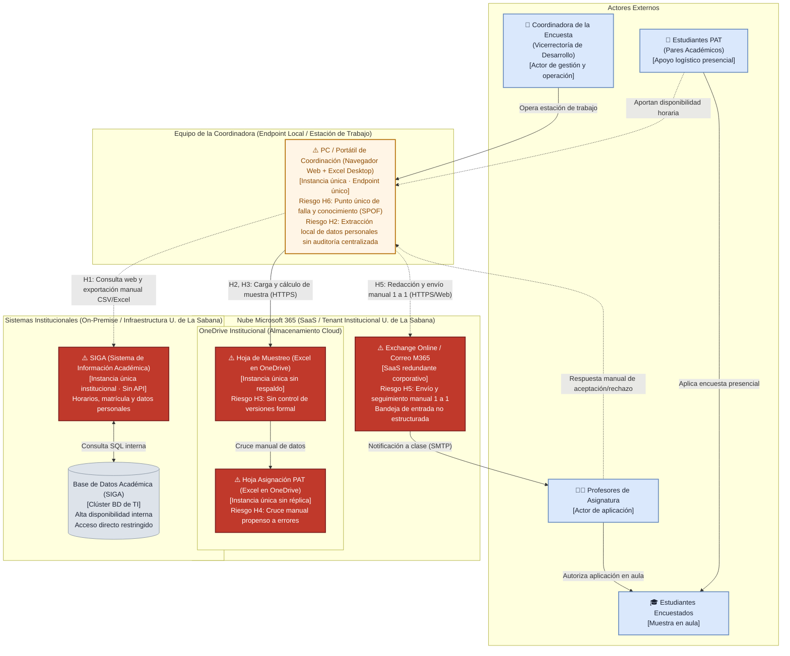

# 📄 Informe Técnico del Taller

## 🔖 Nombre del Taller
**Taller 4 - Mapa de Infraestructura y Diagnóstico Técnico (AS-IS)**

## 👥 Integrantes del equipo
- Julián David Aguilar (Aguilar)
- Juan Esteban Ramírez (Ramírez)

---

## 🧠 1. Descripción general del trabajo

El objetivo del presente taller es modelar y diagnosticar la **infraestructura tecnológica actual (AS-IS)** sobre la cual opera el proceso de logística de la encuesta anual de autoevaluación y satisfacción institucional de la Universidad de La Sabana (gestionado por la Vicerrectoría de Desarrollo, Coordinación de Experiencia y Servicio).

Este taller documenta el estado real existente en la actualidad (*cómo funciona hoy el proceso en términos de infraestructura y activos tecnológicos*), no la solución propuesta. Este mapeo permite identificar con precisión dónde residen los datos, qué componentes procesan la información, cómo fluyen los datos entre sistemas, qué nivel de redundancia existe en cada punto y cuáles son las debilidades, cuellos de botella y puntos únicos de falla (SPOF).

El resultado de este diagnóstico de infraestructura constituye el insumo directo para:
1. El modelado de amenazas y riesgos de seguridad mediante STRIDE (Taller 5).
2. La verificación de cumplimiento normativo y protección de datos personales bajo la Ley 1581 de 2012 (Taller 6).
3. La formulación de la arquitectura de solución automatizada objetivo (*TO-BE*, Taller 7).

---

## 🔧 2. Proceso de desarrollo

Para la construcción del mapa de infraestructura y el diagnóstico técnico, el equipo aplicó la metodología de 5 pasos establecida en la guía del curso:

1. **Identificación de componentes reales:** A partir de las entrevistas con la cliente y la información de la Ficha de Caracterización (Taller 0), el flujo de procesos BPMN (Taller 1) y el modelo de información (Taller 2), se identificaron los activos tecnológicos reales: el Sistema de Información Académica institucional (SIGA) junto con su base de datos corporativa, las hojas de cálculo alojadas en OneDrive para el muestreo y cruce de horarios, el servicio de correo corporativo Exchange Online (Microsoft 365), y la estación de trabajo local (PC/portátil) de la coordinadora.
2. **Agrupación por capas y ubicación de infraestructura:** En lugar de agrupar por roles o flujos funcionales (error común que confunde el mapa de infraestructura con un diagrama de procesos), los componentes se clasificaron estrictamente según el entorno donde residen y se ejecutan:
   - **Sistemas Institucionales (On-premise / Servidores U. de La Sabana):** Servidores de SIGA y clúster de Base de Datos Académica gestionados por la Dirección de TI.
   - **Nube Microsoft 365 (SaaS / Tenant Institucional U. de La Sabana):** Almacenamiento en OneDrive institucional (donde viven las hojas de cálculo) y servicio de mensajería Exchange Online / Outlook.
   - **Equipo de la Coordinadora (Endpoint Local / Estación de Trabajo):** El equipo físico (PC/portátil) donde la coordinadora descarga archivos, ejecuta Excel y redacta correos.
   - **Actores Externos:** Ubicados fuera de los límites de las capas tecnológicas (Coordinadora, Estudiantes PAT, Profesores y Estudiantes encuestados).
3. **Mapeo de conexiones y flujos de tráfico:** Se trazaron las rutas reales de comunicación distinguiendo entre flujos digitales/red (línea sólida) e interacciones manuales/exportes de archivos (línea punteada discontinua).
4. **Determinación de redundancia e instancias únicas:** Para cada componente crítico se evaluó si cuenta con mecanismos de alta disponibilidad/réplica o si opera como una instancia única que represente un punto único de falla (SPOF).
5. **Diagnóstico técnico estructurado y priorizado:** Se categorizaron los riesgos en **Disponibilidad**, **Rendimiento** y **Escalabilidad**, priorizándolos de forma justificada según su criticidad para la continuidad del proceso institucional.

---

## 🧩 3. Análisis del modelo propuesto

### 3.1. Estructura del mapa por capas tecnológicas

El mapa de infraestructura se organiza en tres capas tecnológicas y un conjunto de actores externos claramente delimitados:

1. **Capa de Sistemas Institucionales (Infraestructura U. de La Sabana):**
   - **SIGA (Sistema de Información Académica):** Actúa como la fuente única de verdad para horarios, asignaturas, matrículas, salones y datos personales de docentes y estudiantes. Opera como una **instancia única institucional** sin una API REST/SOAP pública o documentada para integración con otras dependencias.
   - **Base de Datos Académica:** Clúster de base de datos relacional administrado centralmente por la Dirección de TI. Posee alta disponibilidad interna institucional, pero el acceso directo está restringido; la información sólo sale mediante consultas y exportaciones manuales a archivos planos (CSV/Excel).

2. **Capa Nube Microsoft 365 (Tenant Institucional de la Universidad):**
   - **OneDrive Institucional (Almacenamiento Cloud):** Alberga las dos hojas de cálculo operativas del proceso. Aunque OneDrive cuenta con la redundancia del proveedor cloud (SaaS), los archivos en sí operan como **instancias únicas individuales**:
     - *Hoja de Muestreo (Excel):* Instancia única sin versionamiento formal, sin control de concurrencia ni políticas automáticas de backup fuera del repositorio personal.
     - *Hoja de Asignación PAT (Excel):* Instancia única utilizada para el cruce manual de horarios de clase con la disponibilidad de los estudiantes PAT.
   - **Exchange Online / Correo Institucional M365:** Plataforma SaaS de alta disponibilidad para el envío y recepción de correos. Si bien la infraestructura de transporte es redundante, su uso en el proceso actual constituye un severo cuello de botella porque el envío de convocatorias y la lectura de respuestas de los docentes se ejecuta de forma manual, uno a uno.

3. **Capa de Equipo de la Coordinadora (Endpoint Local / Estación de Trabajo):**
   - **PC / Portátil de Coordinación:** Estación de trabajo física cliente (navegador web y cliente de escritorio de Office). Es una **instancia única de endpoint**, constituyendo el punto neurálgico donde convergen la descarga de datos de SIGA, la edición de las hojas de cálculo y la emisión de correos.

4. **Actores Externos (Roles Humanos):**
   - **Coordinadora de la Encuesta (Vicerrectoría de Desarrollo):** Opera el endpoint local, realiza las exportaciones, efectúa el cruce de datos y redacta las notificaciones.
   - **Estudiantes PAT (Pares Académicos):** Aportan su disponibilidad horaria previa y se encargan de la aplicación presencial de la encuesta en los salones de clase. *(Aclaración de rol: No diseñan la muestra ni responden la encuesta).*
   - **Profesores de Asignatura:** Reciben las notificaciones por correo institucional y responden confirmando o rechazando la cesión de minutos de su clase.
   - **Estudiantes Encuestados:** Población estudiantil muestreada que diligencia el formulario físico o digital en el aula durante la sesión asignada.

---

### 3.2. Diagnóstico técnico de riesgos (Hallazgos H1 a H6)

A continuación se presenta la tabla de diagnóstico técnico formal, clasificada en las categorías de **Disponibilidad**, **Rendimiento** y **Escalabilidad**, y priorizada según su impacto en el negocio:

> **Criterio de priorización:**  
> Se asigna prioridad **Alta** a aquellos riesgos que constituyen Puntos Únicos de Falla (SPOF) capaces de detener totalmente la operación o que comprometen la custodia legal y confidencialidad de datos personales (Disponibilidad y Cumplimiento Normativo); prioridad **Media** a los cuellos de botella operativos que degradan sustancialmente los tiempos de respuesta, inducen errores humanos o restringen el crecimiento del proceso (Rendimiento y Escalabilidad); y prioridad **Baja** a ineficiencias secundarias tolerables en el corto plazo.

| # | Componente | Riesgo diagnosticado | Categoría | Impacto si ocurre | Prioridad |
|---|---|---|---|---|:---:|
| **H6** | **Equipo / Operación de la Coordinadora** | **Dependencia de una sola persona (Punto Único de Falla Operativo)** | **Disponibilidad** | Si la coordinadora se ausenta, enferma o renuncia durante el periodo crítico de la encuesta, no existe contingencia, documentación de relevo ni redundancia operativa, paralizando por completo la logística institucional de evaluación. | **Alta** |
| **H3** | **Hoja de Muestreo (Excel en OneDrive)** | **Instancia única sin respaldo formal ni control de versiones** | **Disponibilidad** | Pérdida, corrupción o sobreescritura accidental del archivo de cálculo de la muestra. Imposibilidad de auditar la trazabilidad de la muestra ante comités de acreditación o recuperar el estado sin reiniciar semanas de trabajo manual. | **Alta** |
| **H2** | **Copia de Datos Personales fuera de SIGA** | **Fuga de datos y almacenamiento sin control de acceso granular (RBAC)** | **Disponibilidad / Gobernanza** | Extracción de nombres, correos, horarios y asignaturas a archivos locales y de OneDrive sin cifrado en reposo específico ni bitácora de auditoría de descargas. Riesgo de exposición indebida y sanciones bajo la Ley 1581 de 2012 y política de la universidad. | **Alta** |
| **H4** | **Hoja de Asignación PAT (Excel en OneDrive)** | **Cuello de botella en procesamiento por cruce manual de horarios** | **Rendimiento** | Errores en la detección de conflictos de horario entre docentes y estudiantes PAT; retrasos de días en consolidar el cronograma y necesidad de reprocesos continuos cada vez que un profesor rechaza el horario asignado. | **Media** |
| **H5** | **Correo Institucional (Exchange Online)** | **Cuello de botella en comunicación por gestión manual 1 a 1** | **Rendimiento** | Respuestas no estructuradas de los docentes dispersas en la bandeja de entrada personal de la coordinadora; riesgo de omitir confirmaciones, duplicar asignaciones y demoras críticas en cerrar la programación antes de las fechas límite. | **Media** |
| **H1** | **Sistema Académico Institucional (SIGA)** | **Fuente única sin API de integración (Extracción manual de datos)** | **Escalabilidad** | Desactualización inmediata de la información extraída (cambios de matrícula, retiros, cancelaciones de clase post-exportación no se reflejan). Imposibilidad de escalar el proceso a múltiples facultades sin acuerdos y desarrollos previos de integración con TI. | **Media** |

---

### 3.3. Supuestos del análisis

- **Confirmados con la cliente:**
  - La coordinadora cuenta con permisos directos en SIGA para consultar y exportar listas de estudiantes, horarios y docentes en formato plano (CSV/Excel).
  - Las hojas de cálculo operan en la nube de OneDrive asociada a la cuenta institucional de la coordinadora.
  - La comunicación oficial se realiza mediante el servicio de Exchange Online / Outlook con dominio `@unisabana.edu.co`.
  - La dependencia responsable es la Vicerrectoría de Desarrollo (Coordinación de Experiencia y Servicio).
- **No confirmados (requieren validación con Dirección de TI):**
  - No se confirmó si el sitio/carpeta de OneDrive donde residen las hojas de cálculo tiene habilitada la auditoría unificada de Microsoft Purview o si los enlaces están restringidos contra descargas por terceros.
  - No se confirmó si SIGA cuenta con servicios web (API REST/GraphQL) bloqueados para uso administrativo o si la única vía de acceso corporativa permitida por TI es la interfaz web del sistema.
  - No se confirmó si existe política de retención automática que elimine los archivos planos descargados localmente una vez finalizada la vigencia de la encuesta.

---

## 📈 4. Diagrama final entregado

El diagrama de infraestructura física/lógica actual ha sido modelado en **draw.io** y se encuentra disponible en:
- Archivo editable: [`mapa-final.drawio`](mapa-final.drawio)

### Representación esquemática del mapa de infraestructura AS-IS:

---

## 📋 5. Tabla de actores, entidades o componentes

| Nombre del elemento | Tipo | Ubicación / Capa | Redundancia / Instancia | Descripción y Rol | Responsable |
|---|---|---|---|---|---|
| **Sistema Académico Institucional (SIGA)** | Sistema central | Sistemas Institucionales (U. Sabana) | **Instancia única institucional** | Repositorio central de programas, horarios, salones y datos de matrícula. Sin API pública de integración. *(Riesgo H1)* | Dirección de TI |
| **Base de Datos Académica** | Base de datos | Sistemas Institucionales (U. Sabana) | **Clúster gestionado por TI** | Almacén relacional de SIGA. Posee alta disponibilidad interna corporativa pero acceso externo cerrado. | Dirección de TI |
| **Hoja de Muestreo** | Herramienta | Nube Microsoft 365 (OneDrive) | **Instancia única** | Archivo Excel para cálculo de tamaños muestrales por facultad y programa. Sin backup automatizado. *(Riesgo H3)* | Coordinadora de la encuesta |
| **Hoja de Asignación PAT** | Herramienta | Nube Microsoft 365 (OneDrive) | **Instancia única** | Archivo Excel para cruzar manualmente disponibilidad de estudiantes PAT con horarios de clase. *(Riesgo H4)* | Coordinadora de la encuesta |
| **Exchange Online (Correo M365)** | Servicio SaaS | Nube Microsoft 365 | **Servicio SaaS redundante** | Plataforma de correo corporativo de alta disponibilidad. Utilizado para envío y recepción manual uno a uno. *(Riesgo H5)* | Dirección de TI (Tenant M365) / Coordinadora |
| **PC / Portátil de Coordinación** | Endpoint / Estación cliente | Equipo de la Coordinadora (Local) | **Instancia única (Endpoint)** | Dispositivo físico de trabajo donde se descargan los datos, se manipulan archivos y se opera el correo. *(Riesgos H2, H6)* | Coordinadora de la encuesta |
| **Coordinadora de la Encuesta** | Actor humano | Externo (Gestión) | **Operador único (SPOF)** | Responsable integral de la logística: exporta de SIGA, calcula la muestra, asigna salones y notifica. | Vicerrectoría de Desarrollo (Johanna Molina) |
| **Estudiantes PAT** | Actor humano | Externo (Apoyo logístico) | **Múltiples participantes** | Estudiantes del Programa de Acompañamiento Tutorial. Reportan su disponibilidad y aplican la encuesta en el aula. | Estudiantes PAT |
| **Profesores de Asignatura** | Actor humano | Externo (Aplicación) | **Múltiples participantes** | Docentes que reciben la notificación por correo y deciden ceder el espacio de su clase para la encuesta. | Docentes de Facultades |
| **Estudiantes Encuestados** | Actor humano | Externo (Aplicación) | **Población muestreada** | Estudiantes que diligencian la encuesta durante la sesión presencial de clase. | Estudiantes de pregrado/posgrado |

---

## 🔍 6. Investigación complementaria

### Tema investigado:
Patrones de infraestructura en procesos administrativos universitarios basados en *Shadow IT* (hojas de cálculo y correo manual) y estrategias de migración hacia plataformas gobernadas de bajo código (Power Platform / M365).

### Resumen:
En instituciones de educación superior es recurrente que los procesos de apoyo y aseguramiento de la calidad académica dependan de un Sistema de Información Académica (SIS/ERP) monolítico y cerrado (como SIGA, Banner o SAP SLCM). Al no disponer de interfaces de programación abiertas (APIs) para áreas no técnicas, las dependencias operativas adoptan de manera informal hojas de cálculo como pseudobases de datos operacionales (*Shadow IT*). Aunque este modelo brinda agilidad inicial a la coordinación, introduce vulnerabilidades severas de infraestructura:
1. **Puntos Únicos de Falla (SPOF):** La pérdida de la estación de trabajo local o la desvinculación del operador interrumpe la continuidad del servicio institucional.
2. **Degradación de Integridad y Rendimiento:** Las hojas de cálculo carecen de integridad referencial, bloqueos de concurrencia y validaciones de esquema, provocando colisiones de horario y reprocesos constantes.
3. **Brechas de Gobernanza y Privacidad:** La extracción no controlada de datos personales a archivos locales viola el principio de circulación restringida de la Ley 1581 de 2012 y la política interna de datos, impidiendo auditorías de acceso.

La arquitectura de referencia documentada por Microsoft (*Power Platform Well-Architected Framework*) establece que la transición ordenada hacia la nube institucional debe preservar la restricción de usar el ecosistema homologado (Microsoft 365), sustituyendo las hojas de cálculo por almacenes estructurados (SharePoint Lists o Dataverse) con control de acceso basado en roles (RBAC) y automatizando los flujos de cruce y notificación mediante Power Automate. Este mapa AS-IS valida técnicamente por qué la modernización de la infraestructura es indispensable no solo para la eficiencia operativa, sino para garantizar la disponibilidad y el cumplimiento legal del proceso.

---

## 📚 7. Referencias

Ver [`referencias.md`](referencias.md) para el detalle bibliográfico de las fuentes técnicas y normativas consultadas.

---

_Este documento hace parte de la entrega oficial del Taller 4 del curso AREM (Arquitectura Empresarial) - Universidad de La Sabana._
